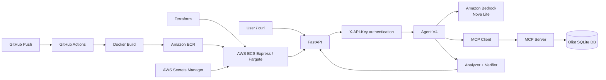

# Agentic Data Analyst

An end-to-end agentic analytics project that turns natural-language business questions into verified SQL analysis over the Olist Brazilian E-Commerce dataset.

The project evolved from a local Bedrock tool-calling agent into a deployable cloud service with an analyzer/verifier workflow, MCP-based database tools, evaluation, API authentication, CI image delivery, and reproducible AWS infrastructure.

## What it does

A user can ask questions such as:

> How many orders are in the database?

or:

> Do late deliveries have a meaningful relationship with customer satisfaction?

The agent inspects tables and schemas, generates read-only SQL, executes queries, verifies the analysis, and returns a grounded answer with supporting evidence.

Example verified result:

```text
99,441 orders
```

For the delivery analysis, the agent found average review scores of approximately:

```text
Late delivery:     2.57
On-time delivery:  4.29
```

## Engineering Highlights

- Analyzer/verifier agent workflow with SQL-based grounding
- MCP-based database tool integration
- Ground-truth evaluation and failure analysis
- FastAPI service with API-key authentication
- Dockerized deployment to AWS ECS/Fargate
- GitHub Actions CI with OIDC-based AWS authentication
- Terraform-based reproducible infrastructure
- AWS Secrets Manager for runtime secrets

## Architecture



### Deployment model

Application delivery and infrastructure deployment are intentionally separate:

```text
git push
   |
   v
GitHub Actions
   |
   +--> syntax checks
   +--> download database from S3
   +--> build Docker image
   +--> push image to Amazon ECR

terraform apply
   |
   v
AWS ECS Express / Fargate
   |
   +--> pulls image from ECR
   +--> injects API_KEY from Secrets Manager
   +--> exposes the FastAPI service

terraform destroy
   |
   v
destroy Terraform-managed cloud resources
```

GitHub Actions currently publishes the container image to ECR. Deployment to ECS is deliberately triggered separately with Terraform so cloud cost remains under manual control.

## Agent evolution

| Version | Main idea | Database tools | Verification |
|---|---|---|---|
| V1 | Baseline Bedrock tool-calling analyst | Direct Python tools | None |
| V2 | More careful analyst prompt with explicit checks | Direct Python tools | Prompt-driven checks and repeat queries |
| V3 | Structured agent workflow | Direct database tools | Analyzer + Verifier workflow |
| V4 | Same reasoning architecture with a cleaner tool boundary | MCP server over SQLite | Analyzer + Verifier workflow |

V4 changes the integration layer rather than trying to make the model inherently smarter: database operations are exposed through MCP while the analyzer/verifier reasoning structure remains the core workflow.

## Evaluation

The project includes a benchmark harness backed by trusted SQL ground truth.

The evaluator records:

- ground-truth coverage
- pass/fail status
- SQL queries
- tool-call count
- tool errors
- model-call count
- token usage
- wall-clock latency
- Bedrock-reported latency

The evaluation work exposed realistic agent failure modes including incorrect aggregation grain, duplicated rows after joins, NULL handling errors, unsupported SQLite functions, incorrect time grouping, SQL timeouts, and plausible-looking answers produced from analytically incorrect SQL.

This is intentional: the project treats evaluation and failure analysis as part of agent engineering rather than optimizing only for demo success.

## Technology stack

**Agent / AI**
- Python 3.11
- Amazon Bedrock
- Amazon Nova Lite
- Analyzer/verifier workflow
- MCP for database tools

**Data**
- Olist Brazilian E-Commerce dataset
- SQLite
- Amazon S3 for the cloud database artifact

**API**
- FastAPI
- Pydantic
- `/health`
- authenticated `/ask`
- `X-API-Key` request header

**Cloud / DevOps**
- Docker
- GitHub Actions
- Amazon ECR
- Amazon ECS Express / AWS Fargate
- AWS IAM
- AWS Secrets Manager
- Terraform

## Repository structure

```text
.
├── api.py
├── mcp_server.py
├── Dockerfile
├── requirements-docker.txt
├── db/
│   └── olist.db
├── eval/
│   ├── questions.json
│   ├── ground_truth.json
│   └── sql/
├── scripts/
│   ├── create_db.py
│   ├── generate_ground_truth.py
│   └── evaluate_agents_safe.py
├── src/
│   ├── db_tools.py
│   ├── agent_v1.py
│   ├── agent_v2.py
│   ├── agent_v3.py
│   └── agent_v4.py
├── terraform/
│   ├── main.tf
│   └── .terraform.lock.hcl
└── .github/
    └── workflows/
        └── ci.yml
```

The SQLite database is intentionally not committed to Git.

## Local setup

Local execution requires AWS credentials with access to Amazon Bedrock.

```bash
python -m venv .venv
source .venv/bin/activate
pip install -r requirements-docker.txt
```

Start the API:

```bash
export API_KEY="your-local-test-key"
uvicorn api:app --host 0.0.0.0 --port 8000
```

Health check:

```bash
curl http://localhost:8000/health
```

Expected:

```json
{"status":"ok"}
```

Ask a question:

```bash
curl -X POST \
  http://localhost:8000/ask \
  -H "Content-Type: application/json" \
  -H "X-API-Key: $API_KEY" \
  -d '{"question":"How many orders are in the database?"}'
```

## Running evaluation

```bash
python scripts/evaluate_agents_safe.py --agents agent_v3 agent_v4
```

The evaluation makes live Bedrock calls, so AWS usage charges may apply.

## CI image delivery

A push to `main` triggers GitHub Actions to:

1. run Python syntax checks
2. authenticate to AWS through GitHub OIDC
3. download the SQLite database from S3
4. build a Linux/AMD64 Docker image
5. push `latest` and commit-SHA tags to Amazon ECR

No long-lived AWS access key is stored in GitHub.

## Cloud deployment with Terraform

The Terraform configuration reuses existing IAM roles, ECR, S3, and the Secrets Manager secret.

Authenticate locally:

```bash
aws login --profile agentic-ai-dev
```

Deploy:

```bash
cd terraform
terraform init
terraform plan
terraform apply
```

Test:

```bash
curl https://<ecs-endpoint>/health
```

Then test the authenticated endpoint:

```bash
read -s API_KEY

curl -X POST \
  https://<ecs-endpoint>/ask \
  -H "Content-Type: application/json" \
  -H "X-API-Key: $API_KEY" \
  -d '{"question":"How many orders are in the database?"}'
```

When finished:

```bash
terraform destroy
```

This keeps the project inexpensive when it is not being used.

## Security choices

- GitHub Actions uses AWS OIDC instead of permanent AWS credentials.
- The API key is stored in AWS Secrets Manager.
- The API key itself is not committed to GitHub or stored directly in Terraform configuration.
- ECS task, execution, and infrastructure permissions are separated through IAM roles.
- The `/ask` endpoint requires the `X-API-Key` header.
